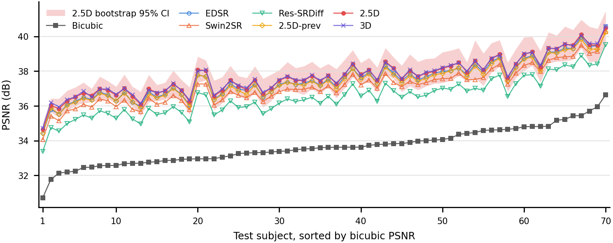
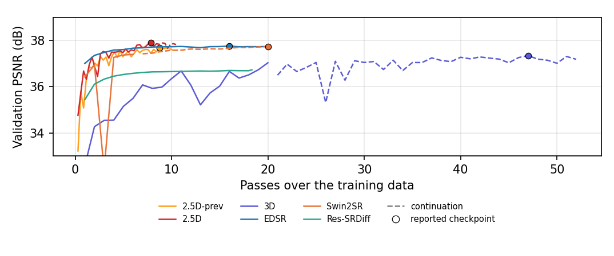
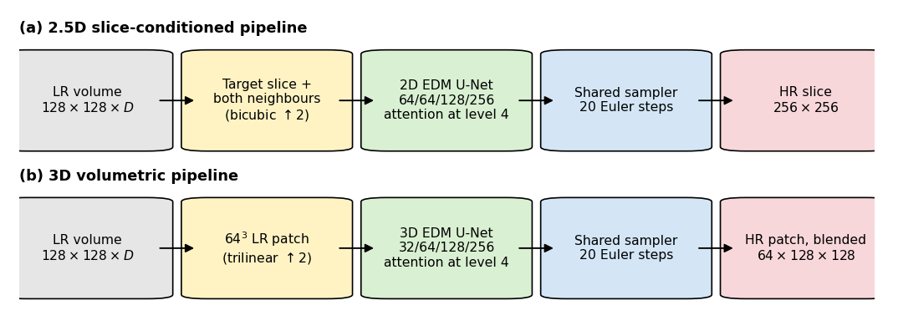

# MRI Super-Resolution via Elucidated Diffusion Models

Comparative analysis of **3D convolutional** and **2.5D slice-conditioned** U-Net architectures for brain MRI super-resolution using the Elucidated Diffusion Model (EDM) framework.

**Pretrained Weights:** [HuggingFace](https://huggingface.co/Chichonnade/Comparative-Analysis-3D-2.5D-MRI-Super-Resolution-EDM) (first preprint version; the checkpoints behind the results below are not uploaded yet)
**Dataset:** [FOMO60K / NKI cohort](https://huggingface.co/datasets/FOMO-MRI/FOMO60K)

## Results

Results of the revised manuscript (IEEE Access resubmission). The task is 2x in-plane super-resolution of sagittal T1 slices (128x128 to 256x256).

Every model is trained from scratch to convergence on 500 subjects of the NKI cohort of FOMO60K. Checkpoints are selected on 6 validation subjects. Evaluation uses 70 held-out subjects and one deterministic 20-step Euler sampler for both EDM models. Numbers are means over subjects.

| Method | Block-avg. PSNR | Block-avg. LPIPS | k-space PSNR | k-space + noise PSNR | IXI fg PSNR | Params |
|---|---|---|---|---|---|---|
| Bicubic | 33.66 | 0.087 | 33.93 | 32.63 | 31.16 | -- |
| EDSR | 37.50 | 0.026 | **35.01** | 33.26 | 33.04 | 1.4M |
| Swin2SR\* | 37.43 | 0.027 | 34.94 | 33.02 | 33.29 | 1.0M |
| Res-SRDiff | 36.48 | 0.008† | 34.20 | 33.00 | 31.54 | 56.7M |
| 2.5D EDM, previous slice | 37.43 | 0.023 | 34.80 | 33.30 | 32.54 | 51.1M |
| 2.5D EDM, both neighbours | 37.70 | **0.022** | 34.98 | **33.54** | 32.77 | 51.1M |
| 3D EDM | **37.72** | 0.023 | 34.87 | 33.24 | **33.65** | 50.7M |

- **Test sets.** *Block-avg.* is the degradation used in training (2x2 block averaging). *k-space* keeps the central half of k-space, which produces Gibbs ringing. *k-space + noise* adds Rician noise on top. No model saw either k-space degradation in training. *IXI* is a zero-shot test on 70 skull-stripped subjects of the IXI cohort (three London hospitals, three scanners). Its score is PSNR over brain pixels only, because the empty background inflates plain PSNR.
- **Footnotes.** † Res-SRDiff trains on the same LPIPS network that is used as the metric, so its LPIPS is not comparable. \* Swin2SR stopped at its 20-epoch cap while still improving slightly on validation; every other model stopped by the early-stopping rule.

Neither architecture dominates. On the training degradation the 3D model and the both-neighbours 2.5D model are tied, and both are 0.2 dB ahead of EDSR. The 2.5D model copes better with a change of degradation: it ties EDSR on k-space and leads every metric with noise. The 3D model copes better with a change of cohort and leads on IXI.

Five sampling steps give the same accuracy as twenty. At five steps a 176-slice volume takes 28 s with the 2.5D model and 88 s with the 3D model on one A100. These results supersede those of the first preprint version.



*Per-subject PSNR on the 70 block-averaged NKI test volumes, with a bootstrap 95% band for the both-neighbours 2.5D model.*



*Validation PSNR of every run during training, including the continuation that trains each model until validation stops improving. Circles mark the reported checkpoints.*

## Architecture

Both models use the EDM framework (Karras et al. 2022) adapted from DIAMOND:

- **3D EDM**: a 3D convolutional U-Net with channels [32, 64, 128, 256] and self-attention at the deepest level. It trains on 64^3 low-resolution patches and runs inference with a sliding window (one-quarter overlap, linear blending).
- **2.5D EDM**: a 2D U-Net with channels [64, 64, 128, 256]. It conditions on the previous and the next low-resolution slice; a previous-slice-only variant is kept as an ablation.
- **Sampler**: both models use the same deterministic Euler sampler, 20 steps from sigma 5 to 0.002.



## Quick Start

### Install

```bash
pip install -e .
```

### Preprocess data

```bash
python src/raw_data/scripts/main.py src/processed_data_mri src/raw_data/FOMO60K/PT015_NKI \
  --mode 2d --axis sagittal --scale-factor 2
```

### Train 2.5D model (local)

```bash
python src/main.py --config-name trainer_mri \
  common.devices=cpu \
  training.num_final_epochs=10 \
  upsampler.training.batch_size=4 \
  upsampler.training.grad_acc_steps=8
```

### Train on Vertex AI (cloud)

```bash
python scripts/launch_vertex_training.py \
  --preprocessed-data-uri gs://your-bucket/processed_data_mri \
  --project your-project --region us-central1 \
  --service-account your-sa@project.iam.gserviceaccount.com \
  --image-uri your-image-uri \
  --artifact-bucket-uri gs://your-bucket/diamond \
  --epochs 10 --push-latest --yes
```

For 3D training, add `--mode 3d`; for the MRI-trained Swin2SR baseline, add `--mode swin2sr`.

### Run inference

```bash
# 2.5D inference from a cloud run
python scripts/run_inference_from_bucket.py run-YYYYMMDD-HHMMSS --evaluate

# 3D inference (local)
PYTORCH_ENABLE_MPS_FALLBACK=1 python scripts/run_inference_3d.py \
  --checkpoint path/to/model_final.pt --num-samples 6 --num-steps 20
```

### Evaluate

Every reported number comes from `scripts/evaluate_sr.py`, which writes per-slice metrics for one method. `scripts/compare_sr.py` then turns those into per-subject statistics and paired tests. `<split>` is a folder with `low_res/test` and `full_res/test`.

```bash
python scripts/evaluate_sr.py --method 25d --checkpoint agent_best_val.pt --sampler shared --num-steps 20 \
  --override agent.upsampler.inner_model.num_next_slices_conditioning=1 --data-dir <split> --lpips --out 25d.csv
python scripts/evaluate_sr.py --method 3d --checkpoint model_best_val.pt --num-steps 20 --patch-size 64 \
  --data-dir <split> --lpips --out 3d.csv
python scripts/evaluate_sr.py --method bicubic --data-dir <split> --lpips --out bicubic.csv
python scripts/compare_sr.py *.csv --reference bicubic --out summary
```

## Project Structure

```
config/              Hydra configs (trainer_mri.yaml, agent/mri.yaml, env/mri.yaml)
scripts/             Vertex launchers, inference, evaluation, paper figures
src/
  main.py            2.5D training entry point (Hydra)
  trainer.py         2.5D training loop (EDM upsampler)
  train_3d.py        3D training entry point (argparse)
  train_swin2sr.py   Swin2SR baseline trained on the MRI slices
  agent.py           Wrapper holding the 2.5D upsampler
  models/
    diffusion/       EDM denoiser + sampler (2D + 3D variants)
    blocks.py        2D UNet building blocks
    blocks3d.py      3D UNet building blocks
  data/
    dataset.py       2D slice dataset
    dataset_3d.py    3D patch/volume dataset
  raw_data/scripts/
    main.py          FOMO60K NIfTI -> LR/HR training pairs
    view_mri.py      NIfTI viewer for visual QC
  metrics.py         PSNR, SSIM, LPIPS implementations
results/paper_v1/    Per-slice baseline metrics from the original submission
```

## Authors

- **Hendrik Chiche**
- **Eshaan Gulati**
- **Ludovic Corcos**
- **Logan Rouge**

In collaboration with GENCI.

## License

This project adapts the [DIAMOND](https://github.com/eloialonso/diamond) codebase for MRI super-resolution.
